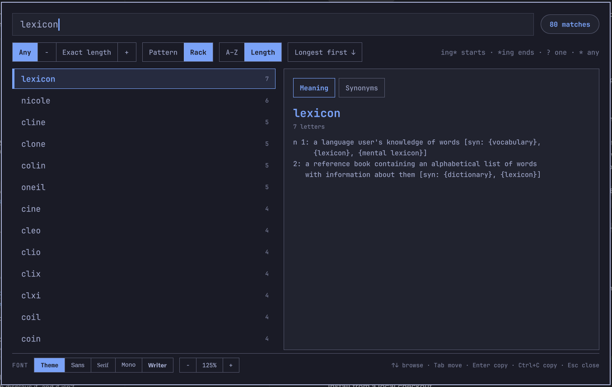

# omarchy-lexicon

[](https://buymeacoffee.com/jasonwheri6)

A fast, offline word finder and dictionary for [Omarchy](https://omarchy.org), one shortcut away.

- **Find words.** Type letters or a pattern (`ing*`, `s?ar`) and see every matching word. Rack mode lists the words you can make from a set of letter tiles, which helps with Scrabble, crosswords and other word games.
- **Look them up.** See a word's definition and synonyms side by side, from dictionaries stored on your own machine.
- **Stay on the keyboard.** Lexicon opens as an overlay on your desktop, and `Enter` copies the chosen word to your clipboard.



## Features in detail

- Native Omarchy `OverlayWindow` plugin (`acme.lexicon`) with live search as you type
- Wildcard (`*`, `?`, `.`), substring, and regular-expression pattern matching
- Exact word-length filter (`0` for any length, `1–32` for exact length)
- Rack tile-pool mode: matches words that can be formed from the supplied letters, honoring repeated letters up to their tile count and automatically clearing the length filter when enabled
- Alphabetical (`A–Z` / `Z–A`) and letter-quantity (`Letters` shortest-first / longest-first) sorting
- Split view: a word list with letter counts beside a detail card with `Meaning` (`dictd` WordNet) and `Synonyms` (`dictd` Moby Thesaurus) tabs. Inflected words without an entry fall back to the closest one (e.g. `flamethrowers` → `flamethrower`)
- Persistent session ring (last three searches with `Ctrl+Up` / `Ctrl+Down` and `Ctrl+Backspace` to reset)
- Independent appearance settings: five in-app font options (`Theme`, `Sans`, `Serif`, `Mono`, `Writer`) and UI scaling (`75%–200%` via `−` / `+` buttons or `Ctrl +` / `Ctrl -`, `Ctrl+0` to reset)
- `wl-copy` clipboard integration (`Enter` copies the focused word and closes; `Ctrl+C` copies while staying open)

## Installation

### 1. Install the word list and dictionaries

Lexicon doesn't include its own word list or dictionaries. It uses standard Arch packages instead, so they stay up to date and other apps can share them. Omarchy's plugin manager only copies the plugin's files: it can't install system packages or start services. That's why this is a one-time step you run yourself.

| Package | Source | What it's for |
|---|---|---|
| `words` | Official | The word list. **Required** to find words |
| `dictd` | Official | The local dictionary server behind the `Meaning` and `Synonyms` tabs |
| `wordnet-dictd` | AUR | Definitions (`Meaning` tab) |
| `dict-moby-thesaurus` | AUR | Synonyms (`Synonyms` tab) |

```bash
sudo pacman -S --needed words dictd
yay -S --needed wordnet-dictd dict-moby-thesaurus
sudo systemctl enable --now dictd
```

If `dictd` was already running, restart it so it picks up the new dictionaries:

```bash
sudo systemctl restart dictd
```

To check, run `dict -h localhost -D`: the list should include `wn` and `moby-thesaurus`. The dictionaries are optional. Without them, word search still works and the detail card shows "Dictionary unavailable".

### 2. Install the plugin

#### With Omarchy's plugin manager (Recommended)

```bash
omarchy plugin add https://github.com/jasonwheritage/omarchy-lexicon.git --enable
```

#### From a local checkout

```bash
git clone https://github.com/jasonwheritage/omarchy-lexicon.git
cd omarchy-lexicon
./install.sh
```

`./install.sh` installs the self-contained plugin and its Python search engine modules into `~/.config/omarchy/plugins/acme.lexicon`, writes default configuration to `~/.local/etc/omarchy-lexicon/default.conf` (when absent), registers `acme.lexicon` in `~/.config/omarchy/shell.json`, and restarts `omarchy-shell` so the overlay is immediately available.

#### As an Arch package (`PKGBUILD`)

```bash
makepkg -si
```

`pacman` lists the dictionary packages as optional dependencies. This packages the plugin tree under `/usr/share/omarchy-lexicon/plugins/acme.lexicon` and installs `/etc/omarchy-lexicon/default.conf` and `/usr/share/doc/omarchy-lexicon/README.md`.

### Uninstall

```bash
./uninstall.sh
```

This removes the plugin and its entry in `shell.json`, but keeps your configuration and saved searches. To delete those as well:

```bash
./uninstall.sh --purge
```

## Launching the overlay

Toggle the overlay from the shell command or bind it in `~/.config/hypr/bindings.lua`:

```bash
omarchy-shell shell toggle acme.lexicon
```

Example Hyprland binding in `~/.config/hypr/bindings.lua`:

```lua
o.bind("SUPER + SHIFT + D", "Lexicon", { panel = "acme.lexicon" })
```

## Overlay controls

| Control | Keyboard | Mouse |
|---|---|---|
| Search pattern | Type directly in the search box (`*` any, `?` or `.` single letter) | Click the search box; text selection is supported |
| Length filter | Arrow to the length group, then type digits (`0–9`) or `Backspace` | Click `Any`, `−` or `+` |
| Pattern / Rack mode | Arrow to `Pattern \| Rack` and press `Space` | Click `Pattern` or `Rack` |
| Sort key | Arrow to `A–Z \| Length` and press `Space` | Click `A–Z` or `Length` |
| Sort direction | Arrow to the direction chip and press `Space` (or `Ctrl+Left` / `Ctrl+Right`) | Click the direction chip |
| Scale (`75%–200%`) | `Ctrl +` / `Ctrl =` to enlarge, `Ctrl -` to shrink, `Ctrl+0` to reset | Click `−` or `+` in the footer; click the percentage to reset |
| Font family | Persisted independently of search history; `Ctrl+Shift+0` resets | Click `Theme`, `Sans`, `Serif`, `Mono`, or `Writer` in the footer |
| Words / Meaning / Synonyms | Arrow keys or `Tab` / `Shift+Tab` between zones; `←` / `→` switches detail tabs; `Ctrl+T` opens `Synonyms` | Click a word to inspect it; click a synonym to open its meaning |
| Copy & dismiss | `Enter` copies focused word and closes; `Ctrl+C` copies; `Escape` closes | Click outside the card to close |

## Configuration

WordNet (`wn`) and Moby (`moby-thesaurus`) are the default dictionary databases, and `/usr/share/dict/words` is the default word list. To change them, put your settings in `~/.config/omarchy-lexicon/default.conf`. That file always takes priority, and installing, upgrading or uninstalling Lexicon never changes it. A system-wide `/etc/omarchy-lexicon/default.conf` also works; when you upgrade the Arch package, pacman keeps your edited copy and saves the new default as `default.conf.pacnew`.

The installer's only change outside Lexicon's own folders is adding `{"id": "acme.lexicon"}` to the `plugins` list in `~/.config/omarchy/shell.json`; uninstalling removes it. Both keep the rest of the file and its formatting as they are, and leave it untouched if it can't be read safely.

Settings:

```ini
WORDLIST_PATH=/usr/share/dict/words
SORT_MODE=alpha
DEFAULT_LENGTH=
MIN_LENGTH=
MAX_LENGTH=
DEFAULT_PATTERN=
PATTERN_MODE=auto
DEFAULT_RACK=
DICTIONARY_DATABASE=wn
THESAURUS_DATABASE=moby-thesaurus
```

## Repository layout

```text
omarchy-lexicon/
├── README.md
├── LICENSE
├── preview.png
├── PKGBUILD
├── install.sh
├── uninstall.sh
├── scripts/
│   └── shell_json.py
├── config/
│   └── default.conf
├── plugins/
│   └── acme.lexicon/
│       ├── manifest.json
│       ├── LexiconOverlay.qml
│       ├── session.js
│       ├── search.py
│       └── i18n/
│           └── en.json
├── src/
│   ├── dict_lookup.py
│   ├── lexicon_config.py
│   ├── lexicon_core.py
│   ├── sorters.py
│   └── __init__.py
├── docs/
│   ├── ARCHITECTURE.md
│   ├── INBOX.md
│   ├── RELEASE_NOTES.md
│   ├── UAT.md
│   └── plan/
│       └── plan.md
└── tests/
    ├── test_dict_lookup.py
    ├── test_installation.py
    ├── test_lexicon_core.py
    ├── test_search_gateway.py
    ├── test_session.py
    └── test_user_config.py
```

## Testing

Run the automated test suite from the repository root:

```bash
python3 -m unittest discover -s tests
```

See [docs/ARCHITECTURE.md](./docs/ARCHITECTURE.md) for the plugin architecture and [docs/UAT.md](./docs/UAT.md) for acceptance testing.

## Support

If `omarchy-lexicon` is useful to you, you can [buy me a coffee](https://buymeacoffee.com/jasonwheri6). It's appreciated and helps keep the project going.
